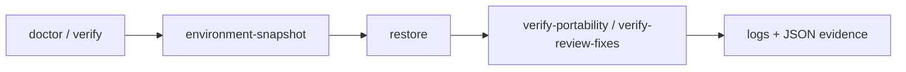

# rekit-tools


[English](README.md) | [中文](README.zh-CN.md)

[](https://github.com/LiLinWilliam/rekit-tools/actions/workflows/ci.yml) [](#testing) [](pyproject.toml) [](LICENSE)
[](https://github.com/LiLinWilliam/rekit-tools/releases/latest) [](pyproject.toml) [](.pre-commit-config.yaml)
[](https://lilinwilliam.github.io/rekit-tools/)

> Auditable, offline-first building blocks for a Windows runtime that should be repairable, portable, and explainable.

## Contents

- [Why rekit-tools?](#why-rekit-tools)
- [30-second start](#30-second-start)
- [Showcase](#showcase)
- [Tools at a glance](#tools-at-a-glance)
- [Architecture](#architecture)
- [Design principles](#design-principles)
- [Quick start](#quick-start)
- [Repository layout](#repository-layout)
- [FAQ](#faq)
- [Roadmap](#roadmap)
- [Contributing and thanks](#contributing-and-thanks)
- [Testing](#testing)

## Why rekit-tools?

Local analysis runtimes tend to accumulate interpreters, native binaries, downloaded archives, and mutable caches. When the root directory moves or one dependency drifts, a repair command should show what it changed and leave the system Python, global PATH, and unrelated user data alone. rekit-tools turns those operations into small, documented commands that produce manifests, logs, verification reports, and stable exit codes.

## 30-second start

This path needs only Python and Pillow and does not touch a rekit installation:

```powershell
python -m pip install -r .\tools\render-entropy\requirements\render.txt
'{"blocks":[{"start":0,"end":256,"entropy":1.0},{"start":256,"end":512,"entropy":6.5}]}' |
  python .\tools\render-entropy\render_entropy.py .\entropy.png
python .\tools\render-entropy\render_entropy.py --version
```

The first command creates `entropy.png`; the second proves which repository version is running. For a real rekit root, start with `doctor --json --no-write`, then follow the [security boundary guide](docs/security-boundaries.md).

`rekit-tools` is a set of auditable Windows tools for a local rekit runtime. It covers environment snapshots, offline restoration, health checks, portability verification, entropy rendering, native launchers, toolchain setup, and Codex session watching. Each tool lives in its own directory and prefers rekit's private runtimes and paths instead of changing the system Python or global PATH.

## Showcase

`render-entropy` accepts binwalk-style `blocks` JSON and produces a fixed-size PNG. The image below was generated by the repository renderer and resized for documentation (the original output is 2048x1024 and about 21 KB).


```powershell
'{"blocks":[{"start":0,"end":512,"entropy":1.2},{"start":512,"end":1024,"entropy":5.8},{"start":1024,"end":1536,"entropy":7.6}]}' | python .\tools\render-entropy\render_entropy.py .\entropy-demo.png
```

The command writes `entropy-demo.png` in the current directory. The renderer normalizes the extension to `.png` and replaces the destination through a temporary file.

## Tools at a glance

| Tool | Purpose | Typical entry point |
| --- | --- | --- |
| `doctor` | Check native tools, Python environments, and key directories | `python tools/doctor/doctor.py --json --no-write` |
| `environment-snapshot` | Record locked package versions and editable-source commits | `python tools/environment-snapshot/02-snapshot-environments.py` |
| `launcher` | Build Windows native launchers and extract `.xz` archives | `python tools/launcher/extract_xz.py <dir>` |
| `migrate-after-move` | Restore environments after moving rekit and run doctor | `pwsh -File tools/migrate-after-move/00-after-move.ps1 --check-only` |
| `render-entropy` | Render JSON entropy blocks to PNG | `Get-Content entropy.json | python tools/render-entropy/render_entropy.py entropy.png` |
| `restore` | Restore virtual environments from locked requirements | `python tools/restore/restore.py --venv render --check-only` |
| `retry-watchdog` | Observe Codex SQLite state and queue controlled retries | `python tools/retry-watchdog/watchdog.py --thread <thread-uuid> --once --dry-run` |
| `toolchain-installers` | Build or configure binwalk, jadx, rizin, and Frida | See the tool directory README |
| `venv-install-all` | Restore all virtual environments through `repair.exe` | `pwsh -File tools/venv-install-all/12-venv-install-all.ps1 --check-only` |
| `verify` | Exercise native boundaries, argument passing, and JSON/PNG acceptance | `python tools/verify/verify.py` |
| `verify-portability` | Verify offline restoration and paths containing spaces | `python tools/verify-portability/verify-portability.py` |
| `verify-review-fixes` | Regress renderer independence, native invocation, and Ghidra heap settings | `python tools/verify-review-fixes/verify-review-fixes.py` |

Each tool documents its parameters, inputs, outputs, exit codes, and side effects in its [`tools/`](tools/) README.

## Architecture

The normal recovery path is deliberately staged. Audit first, capture the current state, restore only the selected environments, then verify the result and portability boundary.



The stages are independent: a snapshot is useful before a restore, and verification can be rerun after a manual change. `migrate-after-move` and `venv-install-all` are wrappers for the restore path; `render-entropy`, launchers, installers, and the retry watchdog stay focused on their own boundary.

## Design principles

- **Offline first:** restore and build commands use local caches by default; network access is an explicit option.
- **Evidence over inference:** write manifests, logs, JSON reports, and deterministic exit codes so another operator can inspect the result.
- **Private runtime boundaries:** prefer the rekit-managed Python, binaries, and toolchain instead of changing global PATH or system interpreters.
- **Explicit authorization:** real samples, devices, protected directories, and Codex sessions belong to the operator; examples use placeholders.
- **Small, composable tools:** each directory has one purpose, a README, and a command that can be tested in isolation.

## Quick start

The renderer only needs Python 3 and Pillow:

```powershell
python -m venv .venv
.\.venv\Scripts\Activate.ps1
python -m pip install -r .\tools\render-entropy\requirements\render.txt
Get-Content .\entropy.json | python .\tools\render-entropy\render_entropy.py .\entropy.png
```

Tools that depend on the rekit root must run in the real rekit root. `<rekit-root>` is a documentation placeholder and must not be replaced with this repository's `tools` directory. Restore and verification scripts write logs, manifests, and temporary results to the rekit root; the repository ignores those runtime artifacts.

## Repository layout

```text
tools/<tool-name>/   One tool and its README
tests/               Pure-function and boundary tests
docs/                Security, troubleshooting, and installation guides
examples/            Minimal commands without real credentials
.github/workflows/   CI and release automation
```

Do not commit `venv/`, `toolchain/`, `samples/`, `logs/`, caches, private session databases, or Frida servers. Run against real samples, devices, or Codex sessions only with authorization; read [`SECURITY.md`](SECURITY.md) and the [security boundary guide](docs/security-boundaries.md) first.

## Contributing

Use `tool/<name>` branches for tools and `docs/<name>` branches for documentation. Before opening a pull request, run `python -m pytest -q tests --cov=tools --cov-report=term-missing`, `git diff --check`, and a sensitive-data scan. See [`CONTRIBUTING.md`](CONTRIBUTING.md) for the full workflow.

## FAQ

**Does a command modify my global Python or PATH?** No. The tools resolve the rekit-managed runtime and keep generated logs, manifests, backups, and temporary files inside the rekit root.

**Do restore commands require internet access?** No. `restore.py` and the PowerShell wrappers are offline by default. Pass `--online` only when you have authorized index access and need it.

**Can I try the repository without a full rekit installation?** Yes. Use the renderer quick start, `--version`, or the safe smoke example. Doctor, restore, and verification commands need a real rekit root and its private runtimes.

**Why does a README use `<rekit-root>`?** It is a placeholder for a local path. Do not replace it with this repository's `tools` directory; the scripts expect the surrounding rekit layout.

**Where should I look when a check fails?** Start with the command's tool README, then inspect the generated log or JSON evidence and the [troubleshooting guide](docs/troubleshooting.md). The [exit-code contract](docs/exit-code-contract.md) lists stable statuses for automation.

## Roadmap

- Extend pure-function and boundary coverage around restore, verify, and PowerShell wrappers while keeping the measured CI floor honest.
- Publish the docs index as a GitHub Pages reference site and keep tool cards synchronized with each README.
- Add machine-readable summaries for long-running installer and watchdog operations without widening their filesystem boundaries.

## Contributing and thanks

Bug reports, documentation fixes, and narrowly scoped tools are welcome. Please read [`CONTRIBUTING.md`](CONTRIBUTING.md), [`SECURITY.md`](SECURITY.md), and the [documentation index](docs/index.md) before opening a pull request. The project is maintained by LiLinWilliam and builds on the Python, Pillow, pytest, Ruff, pre-commit, and GitHub Actions ecosystems.

## Testing

The current test suite has 33 tests and reports 39% total statement coverage for `tools/` with `pytest-cov`. CI enforces the measured 39% floor; update the badge and floor together when coverage changes.

```powershell
python -m pytest -q tests --cov=tools --cov-report=term-missing --cov-fail-under=39
pwsh -NoProfile -ExecutionPolicy Bypass -File tests/powershell_smoke.ps1
```

The PowerShell smoke check parses every `.ps1` tool and exercises the watchdog
start/stop lifecycle with an injected process boundary, so it does not launch a
real watcher or touch a private runtime. It runs as a separate Windows CI job.
