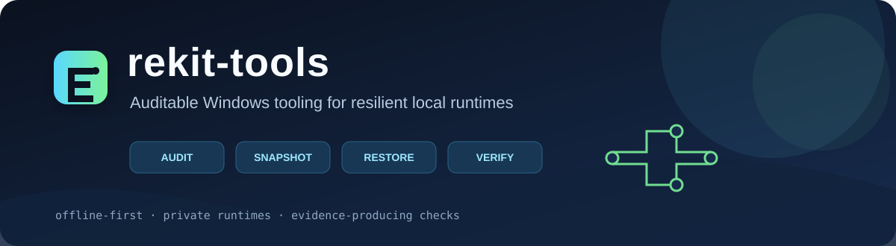
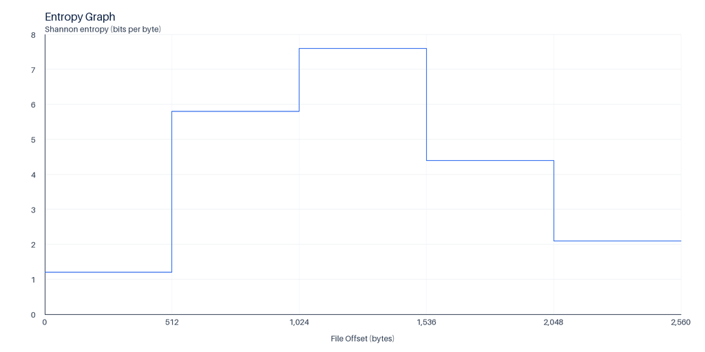
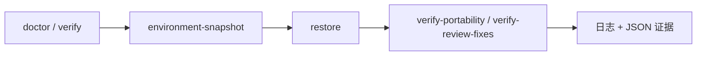

# rekit-tools



[English](README.md) | 中文

[](https://github.com/LiLinWilliam/rekit-tools/actions/workflows/ci.yml) [](#测试) [](pyproject.toml) [](LICENSE)
[](https://github.com/LiLinWilliam/rekit-tools/releases/latest) [](pyproject.toml) [](.pre-commit-config.yaml)
[](https://lilinwilliam.github.io/rekit-tools/)

> 面向 Windows 本地运行时的可审计、离线优先工具集，让修复、迁移和验收都有证据可查。

## 目录

- [为什么需要 rekit-tools](#为什么需要-rekit-tools)
- [30 秒上手](#30-秒上手)
- [展示](#展示)
- [工具速览](#工具速览)
- [架构](#架构)
- [设计原则](#设计原则)
- [快速开始](#快速开始)
- [仓库结构](#仓库结构)
- [常见问题](#常见问题)
- [路线图](#路线图)
- [贡献与致谢](#贡献与致谢)
- [测试](#测试)

## 为什么需要 rekit-tools

本地分析运行时很容易积累多个解释器、原生二进制、下载归档和可变缓存。根目录移动或依赖漂移后，修复命令应该明确说明做了什么，同时不触碰系统 Python、全局 PATH 和无关的用户数据。rekit-tools 将这些动作拆成小而清晰的命令，输出清单、日志、验证报告和稳定退出码，便于复核与自动化。

## 30 秒上手

下面的路径只需要 Python 和 Pillow，不会修改已有 rekit 安装：

```powershell
python -m pip install -r .\tools\render-entropy\requirements\render.txt
'{"blocks":[{"start":0,"end":256,"entropy":1.0},{"start":256,"end":512,"entropy":6.5}]}' |
  python .\tools\render-entropy\render_entropy.py .\entropy.png
python .\tools\render-entropy\render_entropy.py --version
```

第一条命令会生成 `entropy.png`，第二条命令确认实际运行的仓库版本。使用真实 rekit 根目录时，先运行 `doctor --json --no-write`，再阅读[安全边界说明](docs/security-boundaries.md)。

## 展示

`render-entropy` 接收 binwalk 风格的 `blocks` JSON 并生成固定尺寸 PNG。下图由仓库中的真实渲染器生成，再压缩为文档预览（原始输出为 2048×1024，约 21 KB）：



```powershell
'{"blocks":[{"start":0,"end":512,"entropy":1.2},{"start":512,"end":1024,"entropy":5.8},{"start":1024,"end":1536,"entropy":7.6}]}' | python .\tools\render-entropy\render_entropy.py .\entropy-demo.png
```

命令会在当前目录写入 `entropy-demo.png`。脚本会把输出扩展名规范为 `.png`，并通过临时文件替换目标文件。

## 工具速览

| 工具 | 用途 | 真实入口示例 | 文档 |
| --- | --- | --- | --- |
| `doctor` | 检查原生工具、Python 环境和关键目录 | `python tools/doctor/doctor.py --json --no-write` | [页面](https://lilinwilliam.github.io/rekit-tools/tools/doctor.html) |
| `environment-snapshot` | 记录锁定的包版本和 editable 源提交 | `python tools/environment-snapshot/02-snapshot-environments.py` | [页面](https://lilinwilliam.github.io/rekit-tools/tools/environment-snapshot.html) |
| `launcher` | 构建 Windows 原生 launcher 并解压 `.xz` | `python tools/launcher/extract_xz.py <dir>` | [页面](https://lilinwilliam.github.io/rekit-tools/tools/launcher.html) |
| `migrate-after-move` | 移动 rekit 后恢复环境并运行 doctor | `pwsh -File tools/migrate-after-move/00-after-move.ps1 --check-only` | [页面](https://lilinwilliam.github.io/rekit-tools/tools/migrate-after-move.html) |
| `render-entropy` | 把熵块 JSON 渲染为 PNG | `Get-Content entropy.json \| python tools/render-entropy/render_entropy.py entropy.png` | [页面](https://lilinwilliam.github.io/rekit-tools/tools/render-entropy.html) |
| `restore` | 按锁定清单恢复虚拟环境 | `python tools/restore/restore.py --venv render --check-only` | [页面](https://lilinwilliam.github.io/rekit-tools/tools/restore.html) |
| `retry-watchdog` | 只读观察 Codex SQLite 并按策略重试 | `python tools/retry-watchdog/watchdog.py --thread <thread-uuid> --once --dry-run` | [页面](https://lilinwilliam.github.io/rekit-tools/tools/retry-watchdog.html) |
| `toolchain-installers` | 构建或配置 binwalk、jadx、rizin、Frida | `Get-Content tools/toolchain-installers/README.md` | [页面](https://lilinwilliam.github.io/rekit-tools/tools/toolchain-installers.html) |
| `venv-install-all` | 通过 `repair.exe` 恢复全部虚拟环境 | `pwsh -File tools/venv-install-all/12-venv-install-all.ps1 --check-only` | [页面](https://lilinwilliam.github.io/rekit-tools/tools/venv-install-all.html) |
| `verify` | 验收原生边界、参数传递和 JSON/PNG | `python tools/verify/verify.py` | [页面](https://lilinwilliam.github.io/rekit-tools/tools/verify.html) |
| `verify-portability` | 验证离线恢复和含空格的路径 | `python tools/verify-portability/verify-portability.py` | [页面](https://lilinwilliam.github.io/rekit-tools/tools/verify-portability.html) |
| `verify-review-fixes` | 回归渲染器独立性、原生调用和 Ghidra 堆设置 | `python tools/verify-review-fixes/verify-review-fixes.py` | [页面](https://lilinwilliam.github.io/rekit-tools/tools/verify-review-fixes.html) |

每个工具的参数、输入、输出、退出码和副作用都写在对应的 [`tools/`](tools/) README 中。

## 架构

常规恢复路径被刻意拆成多个阶段：先审计，再记录当前状态，只恢复选定环境，最后验证结果与可迁移边界。



每个阶段都可以独立重复：快照适合在恢复前保存基线，验证也可以在手工修改后再次运行。`migrate-after-move` 和 `venv-install-all` 是恢复路径的包装器；熵渲染、launcher、安装器和 retry watchdog 各自保持边界。

## 设计原则

- **离线优先：** 恢复和构建默认使用本地缓存，联网必须显式传参。
- **证据优先：** 输出清单、日志、JSON 报告和确定的退出码，让别人能够复核结果。
- **运行时隔离：** 优先使用 rekit 管理的 Python、二进制和工具链，不修改全局 PATH 或系统解释器。
- **明确授权：** 真实样本、设备、受保护目录和 Codex 会话都属于操作者，示例只使用占位符。
- **小而可组合：** 每个目录只负责一个目的，拥有自己的 README，并可单独验证。

## 快速开始

渲染器只需要 Python 3 和 Pillow：

```powershell
python -m venv .venv
.\.venv\Scripts\Activate.ps1
python -m pip install -r .\tools\render-entropy\requirements\render.txt
Get-Content .\entropy.json | python .\tools\render-entropy\render_entropy.py .\entropy.png
```

依赖 rekit 根目录的工具必须在真实 rekit 根目录中运行。`<rekit-root>` 只是文档占位符，不能替换成此仓库的 `tools` 目录。恢复与验收脚本会把日志、清单和临时结果写回 rekit 根目录，仓库规则会忽略这些运行产物。

## 仓库结构

```text
tools/<tool-name>/   工具及其 README
tests/               纯函数与边界测试
docs/                安全边界、排错和安装指南
examples/            不含真实凭据的最小命令示例
.github/workflows/   CI 与发布自动化
```

不要提交 `venv/`、`toolchain/`、`samples/`、`logs/`、缓存、私有会话数据库或 Frida server。涉及真实样本、设备或 Codex 会话时，只能在获得授权的本地环境运行，并先阅读 [`SECURITY.md`](SECURITY.md) 与[安全边界说明](docs/security-boundaries.md)。

## 常见问题

**命令会修改全局 Python 或 PATH 吗？** 不会。工具会解析 rekit 管理的运行时，并把日志、清单、备份和临时文件留在 rekit 根目录内。

**恢复命令需要联网吗？** 不需要。`restore.py` 和 PowerShell 包装器默认离线；只有在明确获授权且确实需要时才传入 `--online`。

**没有完整 rekit 安装可以试用吗？** 可以。先运行渲染器快速开始、各入口的 `--version` 或安全 smoke 示例。doctor、restore 和验收工具需要真实 rekit 根目录及其私有运行时。

**为什么文档里有 `<rekit-root>`？** 它代表本地路径占位符，不应替换为本仓库的 `tools` 目录；脚本需要周围的 rekit 目录结构。

**检查失败后先看哪里？** 先看对应工具 README，再查看生成的日志或 JSON 证据，然后阅读[排错清单](docs/troubleshooting.md)。稳定退出码见[退出码约定](docs/exit-code-contract.md)。

## 路线图

- 在保持覆盖率数字真实的前提下，继续补充 restore、verify 和 PowerShell 包装器的边界测试。
- 将 docs 首页发布为 GitHub Pages，并让工具卡片与各工具 README 保持同步。
- 为安装器和 watchdog 增加机器可读摘要，同时不扩大现有文件系统边界。

## 贡献与致谢

欢迎提交问题、文档修正和边界清晰的新工具。提交前请阅读 [`CONTRIBUTING.md`](CONTRIBUTING.md)、[`SECURITY.md`](SECURITY.md) 和[文档导航](docs/index.md)。项目由 LiLinWilliam 维护，感谢 Python、Pillow、pytest、Ruff、pre-commit 和 GitHub Actions 社区提供的基础设施。

## 测试

当前测试套件包含 49 项测试，使用 `pytest-cov` 测得 `tools/` 总语句覆盖率为 49.35%。CI 将实测的 49% 作为门槛；覆盖率变化时请同步更新徽章和门槛。

```powershell
python -m pytest -q tests --cov=tools --cov-report=term-missing --cov-fail-under=49
```
